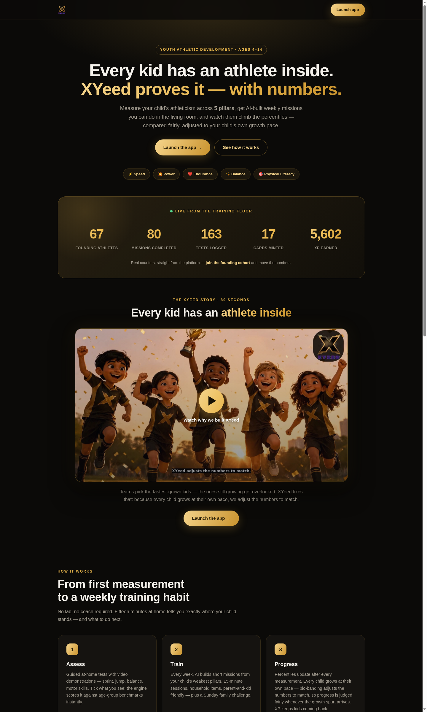
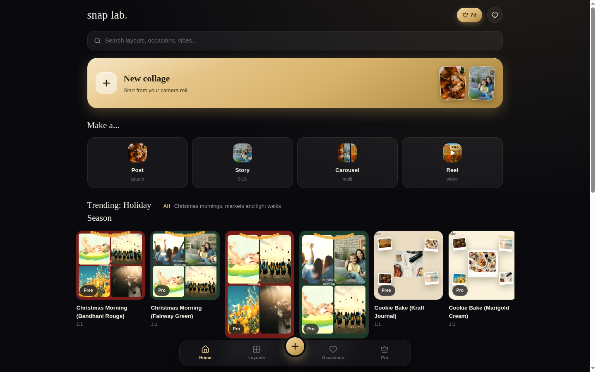

# XYeed Inc: Product Showcase

XYeed Inc is a Delaware C-corp building AI-powered consumer products. Four
products, one shared platform stack, all designed, built, and operated
end to end: product, frontend, backend, database, mobile, CI/CD, and
cloud infrastructure.

> Source code is private by design. This repository is the public
> evidence trail: what each product does, how it is built, and where it
> runs. Code review access can be granted on request.

---

## 1. Kids Fitness (XYeed): youth athletic development platform

**Live in production:** https://xyeed.com

A youth athletic-development platform for kids 4 to 18, used by parents.
Parents run guided at-home assessments across five physical-literacy
pillars (Speed, Power, Balance, Endurance, Skills), the engine scores
results against age-band norms, and an AI planner builds a personalized
weekly mission plan. Gamified with XP, coins, streaks, and collectible
athlete trading cards. Includes a moderated community (posts, stories,
DMs, groups, challenges) and a local facility directory that ingests
real recreation catalogs and notifies parents when matching programs
open for registration.

The counters on the live site are real, served straight from the
production API (`/api/public-stats`), not marketing copy.

**Highlights**

- COPPA-aware architecture: parents hold accounts, children never do
- Age-band percentile engine with bio-banding, adjusted to each child's
  growth pace
- Free Play timed and reps activities with personal-best history and
  WebAudio beep-test schedules
- Facility ingestion adapters (RecDesk, CommunityPass, SportsEngine)
  with cron diff detection and age-matched push notifications
- Full EN + ES internationalization
- Report/block UGC moderation, account deletion, on-device camera
  measurement (App Store review compliant)

**Stack:** React 18, Vite, Tailwind, tRPC, Hono, Drizzle ORM, MySQL on
Google Cloud SQL, Cloud Run, Capacitor 8 (iOS shipped, Android
pipeline ready), FCM + APNs push, Codemagic CI.

---

## 2. Snap Lab: photo and video collage studio

**Live in production:** https://snaplab-796272357891.us-central1.run.app

A mobile-first collage studio. Pick photos and clips, choose from a
trending layout catalog, and export polished posts, stories, carousels,
and reels at 1080x1080, 1080x1350, and 1080x1920. Free and Pro tiers,
occasion-based collections, and AI-assisted layout suggestions.

**Highlights**

- Real-time canvas rendering with PNG/JPG and MP4/WebM export
- Server-side video moderation pipeline (Sightengine) on user uploads
- Shipped to TestFlight as a native iOS shell via Capacitor

**Stack:** React 19, TypeScript, Vite 7, Tailwind, shadcn/ui, Hono,
tRPC 11, Drizzle ORM, MySQL, Cloud Run, Capacitor, Codemagic CI with
automatic signing.

---

## 3. KidzAI: a learning universe that teaches kids how AI works

**Status:** v6.2 complete, deploy-ready (production runbook, Docker
image, and iOS pipeline prepared). Public launch pending.

A learning platform that gives kids real AI literacy through play:
60+ interactive experiences including an AI Universe of themed planets
(fairness, guardrails, feed simulation, detective games), spelling,
math, geography and science bees, a voice-enabled AI buddy, a book
library, craft and comic studios, vibe coding for kids, and a
PIN-protected parent zone with progress digests.

**Highlights**

- 609 automated tests green (vitest), typed end to end
- Multi-model backend (Moonshot Kimi + Google Gemini) behind a
  moderation layer designed for child safety
- Curated seed content: 12 books, badge economy, academies, gift catalog

**Stack:** React, TypeScript, Vite, Hono, Drizzle ORM, TiDB (MySQL
compatible), Docker on Cloud Run, Capacitor iOS, Codemagic CI.

---

## 4. FORME: virtual fitting room for iPhone

**Status:** TestFlight pipeline ready (Codemagic automatic signing,
bundle ID registered).

A native iOS app for virtual try-on. Build a personal avatar, manage a
digital closet of garments, and preview outfits in a fitting room
rendered by a private GPU inference server. Camera and photo-picker
capture, parallax motion effects, and a job engine that tracks queued,
running, and completed renders.

**Stack:** SwiftUI, AVFoundation + Vision pipeline, Keychain credential
storage, async job engine against a private GPU try-on backend,
Codemagic CI.

---

## The shared platform

All four products reuse one hardened operating stack, which is why a
small team can ship this many surfaces:

- **Backend:** Hono + tRPC + Drizzle ORM on MySQL-compatible databases
- **Infra:** Google Cloud Run + Cloud SQL, Docker, Secret Manager
- **Mobile:** Capacitor shells + Codemagic automatic-signing pipelines
  to TestFlight
- **Quality:** typed end to end, automated test suites, real-data-only
  policy (no fake counters, no fake testimonials)

## Contact

Interested in the code behind any of these? Open an issue in this
repository or reach out via https://xyeed.com and we can arrange read
access under NDA.
